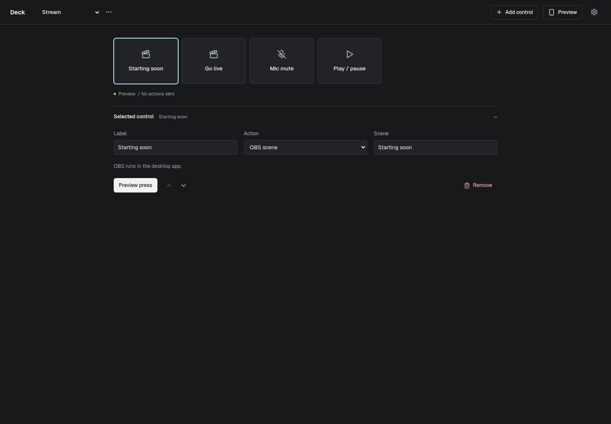

# zDeck

**Build a control deck on your computer. Use it there, or put it on your phone.**

zDeck is a free, MIT-licensed desktop app for arranging buttons and sliders into pages that control your applications. The React editor runs in a Tauri desktop shell; an approved phone can run your saved controls through a private HTTPS connection. A browser-only build lets you design and rehearse without controlling anything.



[Quick start](#quick-start-from-source) · [Connect a phone](#put-your-deck-on-a-phone) · [Platform support](#features-and-platform-support) · [Plugins](#plugins) · [Development](docs/development.md)

## What you can do

- **Undo mistakes in the editor:** Undo or redo page, section, control, layout, and appearance changes during the current session. Deleted controls and sections also land in a bounded Trash (the newest 10) with a Restore action; page deletion stays undo-only. Undo only changes saved deck configuration; it never reverses a control action that already ran. History is session-only and is cleared when the authoritative deck reloads; Trash is saved locally beside the deck.
- **Make your own deck.** Add, duplicate, label, configure and reorder controls; organize them into pages and ordered sections. Insert, duplicate, rename, reorder or remove sections, with optional theme and accent overrides that otherwise follow the deck. Appearance keeps Dark as the default and adds opt-in Glass and Wasteland Terminal themes: Glass pairs a bright Control Center-inspired lavender wallpaper with individual translucent smoked controls, while Wasteland Terminal uses olive-black instrument panels, pale phosphor text, system monospace, angular tiles and static scanlines.
- **Navigate your sections.** On the phone, swipe left/right between pages and up/down between sections, without a persistent navigation footer. Taller sections scroll naturally until their boundary; keyboard and screen-reader navigation remain available. On desktop, scroll through sections and use left/right arrow keys between pages when not operating another control. Existing decks migrate automatically; reload an older companion client after upgrading.
- **Try it safely.** Setup rehearsals and the phone preview simulate presses. Desktop tiles start in **Preview** each session.
- **Run saved controls.** Explicit desktop **Live** mode needs no phone service. Switch OBS program scenes, or use built-in microphone, volume and media controls on macOS, Windows and Linux.
- **Use a phone as the deck.** Pair and approve it on the desktop, receive saved deck updates, and run controls from the authenticated phone surface. Revoke access from Settings.
- **Extend it with local plugins.** Install a reviewed plugin folder and explicitly enable it. The included Spotify reference plugin targets macOS and is separate from the built-in media control.

**Current status: source/developer preview, not a finished cross-platform release.** This repository documents running and building from source; it does not offer a verified desktop installer/download workflow. The checked-in bundle targets are Linux `.deb` and AppImage, but packaging is not validated. Windows, macOS and Linux are required project targets; that requirement is **not** a claim of feature parity today.

## Quick start from source

### 1. Try the editor — no desktop actions

You need Git, **Node.js 22.18+** and **npm 10+**. From a terminal:

```sh
git clone https://github.com/ZaneH/zdeck.git
cd zdeck
npm ci
npm run dev
```

Open <http://localhost:1420>. Complete or skip setup, add a control, edit it in the Inspector, and use **Preview** to see the phone layout. The direct preview URL is <http://localhost:1420/#/phone>.

Right-click an editor tile (or use Shift + F10 while it is focused) for **Rename** and **Delete**. The footer power button is red while controls are off and green while armed. Installation diagnostics can be hidden after running them and reopened by running Diagnostics again.

System-volume slider targets are remembered locally across sessions, separately from exported decks. Restoring a target does not change system audio or arm controls; persistence failures remain visible.

This browser build saves locally in that browser. It does **not** pair a phone or execute desktop controls. Opening the development server on another device is not the authenticated phone setup.

### 2. Run the desktop app — for real controls

Install Rust and the [Tauri 2 prerequisites for your OS](https://v2.tauri.app/start/prerequisites/). On **NixOS/x86_64-linux**, the repository provides a pinned development shell:

```sh
nix develop
npm ci
npm run tauri:dev
```

On other systems, after installing the platform prerequisites, run `npm ci` and `npm run tauri:dev` from the checkout. The Nix shell is Linux-only; macOS/Windows native builds and packaging still need verification. See [native development notes](docs/development.md#native-development) for Linux dependencies and known WebKit issues.

### 3. Configure, save, then run

1. Add the controls you want and configure their targets in the Inspector. Wait for **Saved**.
2. For OBS, enable its WebSocket server, then connect in **Settings → OBS Studio**. For system controls, check the platform requirements below. For plugins, install and enable the plugin first.
3. Stay in **Preview** while editing. When ready, explicitly choose **Live** to run saved tiles on this computer. Editing, changing the editor page or leaving the editor returns to Preview. Volume targets commit on release, not continuously while dragging.
4. Check the reported outcome and the actual application. **Unknown** means an action may have happened: inspect the desktop before trying again. zDeck does not automatically replay uncertain actions.

> **Preview is not a global safety lock.** Native Inspector actions such as **Run scene**, **Toggle** and **Apply** are explicitly real even while desktop tiles are in Preview. Browser and phone-layout previews are always simulated; an approved remote phone runs real actions.

## Features and platform support

“Implemented” below means code exists, not that every platform/device has been physically verified.

| Feature | Linux desktop | macOS desktop | Windows desktop |
| --- | --- | --- | --- |
| Editor, pages, simulated preview, local deck saving | Implemented; native startup previously smoke-tested on AMD/Wayland | Implemented frontend/native store; native verification open | Implemented frontend/native store; native verification open |
| OBS program-scene switching | Shared native adapter | Shared native adapter | Shared native adapter |
| Built-in default microphone mute and output volume | Implemented with `wpctl` / PipeWire / WirePlumber | CoreAudio; reversible saved-level fallback when mute is unavailable | Core Audio; Windows verification open |
| Built-in media play/pause | Implemented with `playerctl` / MPRIS | System media key; Accessibility setup in Inspector | System media key; Windows verification open |
| Local plugin host and catalog | Implemented; plugin-dependent | Implemented; plugin-dependent | Platform-aware code; verification open, plugin-dependent |
| Included Spotify plugin | Unsupported | Implemented via local Spotify Automation; live verification open | Unsupported |
| Private phone service | Shared backend; isolated HTTPS/Chrome tests | Shared backend; native/device verification open | Shared backend; native/device verification open |

macOS playback permission setup is available in the Inspector. Fully sent native media keys stay quiet without claiming playback confirmation; actual timeouts and uncertain failures still warn. The macOS microphone fallback preserves input levels across restarts, but is software attenuation, not a hardware privacy switch. See [system-control verification](docs/system-controls-verification.md) for limitations and outstanding Windows/Linux build and device checks.

**OBS:** Requires OBS Studio 30.2+ / obs-websocket 5.5+. In OBS, open **Tools → WebSocket Server Settings**, enable the server, and use its port (default `4455`) and optional password in zDeck. Connections are loopback-only (`127.0.0.1` / `::1`). After a successful connection, zDeck remembers the port and password in the OS credential store (macOS Keychain, Windows Credential Manager, or Linux Secret Service). Linux needs an available, unlocked Secret Service provider such as GNOME Keyring or KWallet with Secret Service enabled. Storage failures are shown in Settings without preventing connection; passwords are never saved as plaintext fallback. Use **Forget saved connection** to remove them. Saved details are read only when you open Settings → Integrations. Disconnecting keeps the saved details; restarting does not automatically connect to OBS. The adapter is tested against a fake OBS5 peer; real OBS validation remains open.

**Linux system controls:** Install WirePlumber (`wpctl`) and `playerctl`; the Nix shell includes both. Audio needs an active PipeWire/WirePlumber session, and media needs an MPRIS player. Microphone mute affects the **default system input**, not an OBS input; volume affects the **default system output**. Media uses playerctl's default player, not a selected app or a Spotify-specific binding. With several players open, it may target the wrong one. Real audio/media verification remains incomplete.

**Not included:** dial controls, drag-and-drop editing, multi-select, deck export/import, cloud sync, automatic plugin downloads/updates, or bundled Node. See the [roadmap](roadmap.md) for plans, not a list of delivered features.

## Put your deck on a phone

The phone interface is a browser-installable PWA, not an App Store/Google Play package. It needs the **native desktop app**, an explicitly started service, a stable browser-trusted HTTPS origin, and your approval. The desktop app and HTTPS proxy must remain running.

### 1. Choose a private connection

In **Settings → Phone connection**, choose one mode:

| Mode | What you supply |
| --- | --- |
| **Tailscale** | Tailscale on both devices, this computer's `https://computer.tailnet-name.ts.net` root origin, and Tailscale Serve forwarding HTTPS to `http://127.0.0.1:45829` |
| **Local HTTPS** | A reachable private IP or permitted local DNS name, a certificate trusted by the phone, and your own HTTPS reverse proxy to `http://127.0.0.1:45829` |

Enter your actual HTTPS root origin and choose **Start local service**. This starts a **loopback HTTP service only**; zDeck does not configure Tailscale, proxies, certificates, networks or firewalls, and starting it does not prove phone connectivity. Stop the service before changing modes.

For Tailscale, first inspect `tailscale serve status` and review any existing Serve configuration. If appropriate for your setup, deliberately configure:

```sh
# Changes Tailscale Serve configuration; review existing settings first.
tailscale serve --bg --https=443 http://127.0.0.1:45829
```

**Never enable Tailscale Funnel or expose this service publicly.** For the alternative without Tailscale, follow the [manual Local HTTPS recipe and certificate trust precautions](docs/protocol.md#local-https-setup). Do not bypass certificate warnings; transfer only your controlled CA certificate to the phone, never private keys.

### 2. Open, install and pair

1. On the phone, open your configured HTTPS root. It must show **Connect your phone** without a certificate warning.
2. If you want a home-screen app: on iPhone use **Safari → Share → Add to Home Screen**; on Android use the browser's install menu. Launch the installed app before pairing.
3. Create a fresh pairing link in desktop Settings. The QR is generated locally and contains that same invitation. Invitations expire after **two minutes** and are single-use.
4. Paste the link **inside the browser or installed app you intend to use**, name the phone, and choose **Request approval**. Scanning a QR may open a different browser; Safari, Brave and installed apps must not be assumed to share cookies.
5. Approve the named request on the desktop. Confirm your saved pages appear, then deliberately test a reversible action and check the desktop result.

Pair once, then bookmark or revisit the **same HTTPS address in the same browser or installed app**. **Start** remembers the service for future zDeck launches. **Stop** pauses access and disables auto-start but keeps approved phones; **Revoke** forgets a device. Pairings expire 180 days after pairing (or sooner if browser cookies are cleared). Changing the origin or connection method forgets the previous approvals; a new origin may require reinstalling the PWA and re-pairing. Offline/disconnected phones cannot run controls, and presses are not queued for later.

**Validation status:** a user reported a successful connection after manually configuring Tailscale Serve. Automated HTTPS/Chrome tests use the actual Rust service with fake actions. Full physical iPhone/Android installation, real LAN/certificate setup, native admin lifecycle, packaged asset serving and real phone action validation remain open. See the [physical-device checklist](docs/development.md#physical-phone-verification).

## Plugins

**Settings → External plugins is a local folder catalog, not a central registry or marketplace.** Refresh discovers local metadata and probes runtimes; it does not download, install, enable or execute a plugin. JavaScript/TypeScript plugins require installed **Node.js 22.18+**; Python plugins require **Python 3.10+** instead. Neither runtime is bundled. Authors can use the [Python SDK and self-contained example](packages/plugin-sdk-python/README.md) alongside the existing TypeScript SDK.

1. Obtain and review a **complete prepared plugin folder**, including its SDK runtime and licenses. Open the plugin folder from Settings and copy it there. The current location is `~/.config/zdeck/plugins/` (Linux respects an absolute `XDG_CONFIG_HOME`).
2. Choose **Refresh**, then **Enable** on its row. Review source/license/access, check the initially unchecked trust consent, and separately confirm enabling.
3. Add the enabled plugin's actions from **Add control → Plugins**, configure them, save, and deliberately run them in native Live mode, the Inspector or an approved phone.

Up to 16 plugins can be enabled independently. Trust and enablement are remembered across sessions. On launch, zDeck restores enabled plugins only when their installed files still match the trusted package fingerprint. Changed packages require trust again; Disable and Uninstall clear remembered enablement. There is no automatic retry, polling or action replay. The row menu offers local **Diagnostics** and confirmed **Uninstall…**, which stops that plugin and moves its folder to a sibling `plugin-backups` directory. Saved buttons remain. Restore the folder manually and explicitly trust/enable again to recover.

**Plugins are not sandboxed.** They run with your user-level filesystem, network and OS permissions. Install only code you trust. Do not use `npm install` to repair a distributed folder: replace it with a complete prepared artifact instead.

The included **Spotify reference plugin is macOS-only**, controlling an already-open Spotify desktop app through Automation. It offers play/pause, next/previous and Spotify-player volume—not system volume, Spotify Web API, OAuth or account/device selection. Built-in system controls use separate native OS APIs and do not require this plugin. Live Spotify/JXA and permission attribution remain unverified.

See the [plugin installation, recovery and SDK guide](docs/plugins.md) for full instructions. Developers can build a self-contained Spotify folder with `npm run build` followed by `npm run plugin:package:spotify`; this creates `dist/plugins/spotify/`, not an automatic install or download. The npm SDK package and the local plugin catalog are distinct things.

## Security, privacy and saved data

- **Keep access private and approve only your own devices.** Network access alone is not authorization. Device cookies are Secure, HttpOnly and SameSite=Strict; there are no HTTP admin endpoints. Pairing links are sensitive even though approval is still required.
- **Saved controls, not arbitrary remote commands.** Phone requests identify a saved control and revision (plus a bounded volume target when applicable). They cannot supply shell commands, executable paths, OBS credentials or deck edits. Trusted plugins remain a broader, unsandboxed execution boundary.
- **No silent retries.** Results distinguish confirmed, not applied, failed and unknown. An uncertain effect is not proof of failure. Revocation stops future access, not an OS action already underway.
- **Credentials stay out of the deck.** OBS connection details are remembered in the OS credential store, never in decks, exports, browser storage or phone responses. Disconnect ends the live session; **Forget saved connection** deletes the remembered details. Phone approval verifiers and native service settings live in a separate versioned app-data file (`remote.v1.json`), never in the deck. Raw phone tokens remain only in Secure, HttpOnly browser cookies, with a fixed 180-day lifetime enforced by the service. QR generation and fonts are local. API responses are not cached; the service worker caches only allowlisted app-shell assets, not authenticated deck/API responses.
- **Browser and native storage are separate.** Browser editing uses one `localStorage` envelope under `deck.local.v1` holding the deck and its bounded Trash; an older bare deck is read and upgraded on the next save. The desktop uses validated, atomic `deck.v1.json` writes in Tauri's app-data directory (`~/.local/share/com.deck.local/` on typical Linux), with Trash in the same document and revision write. Trash never enters a deck, export or phone response. If the native file is missing, initialization can use the local webview's saved browser deck; there is no ongoing browser-to-desktop sync.
- **Back up deliberately.** There is no deck export/import or automatic backup. Native invalid/newer files are preserved rather than silently overwritten. Current schema v2 can read valid v1 decks; the next explicit edit/save writes v2, which older app versions cannot read. Run only one native app instance against an app-data directory.

**External themes (unreleased):** In the desktop app, open **Settings → General → Installed themes** to preview a local `.zdeck-theme.json` file, explicitly install it, then choose **Use for deck** or apply it through a section’s Appearance menu. The first example is [`Midnight Maze`](packages/themes/midnight-maze.zdeck-theme.json). Packages contain bounded colors/radii and host-rendered motifs, not scripts or arbitrary CSS. The desktop sends referenced appearances to paired phones. See [the format, recovery behavior and verification gaps](docs/theme-packages.md). Registry downloads and independent icon-pack installation are not implemented. Saving uses deck schema v4; older apps cannot read these decks.

**Settings rule:** explicit user configuration is saved when applied and restored across sessions. This includes decks/appearance, plugin trust and enablement, OBS connection details, phone settings/approvals, and close-to-tray. Live mode, pending actions, observed runtime state and other temporary safety state are not restored. Settings errors never prevent launch and failed saves remain visible.

Read the [protocol/security contract](docs/protocol.md), [plugin trust model](docs/plugins.md#trust-and-remaining-compatibility-work) and [persistence/recovery details](docs/development.md#persistence-and-recovery) before relying on remote control.

## Troubleshooting

| Symptom | Check first |
| --- | --- |
| Buttons only simulate | Browser builds and phone-layout previews are simulation-only. In the native editor, save the deck and explicitly choose **Live**. A real phone needs the private service and approval. |
| macOS playback needs permission | Select play/pause in the Inspector and use **Open System Settings**, then enable zDeck in Accessibility. Return and press play/pause again. |
| Linux media controls the wrong app | Inspect `playerctl -l`. zDeck currently uses the default MPRIS selection; choosing a specific player is not implemented. |
| OBS cannot connect | Enable OBS WebSocket, match port/password, and run OBS on the same computer. No remote OBS host is accepted. |
| Phone cannot open the site | Keep app/proxy running; check the exact HTTPS origin, certificate trust, tailnet or permitted LAN reachability and Wi-Fi client isolation. “Start” does not configure HTTPS. Do not disable security checks. |
| Phone requests approval again | Use the same HTTPS address and browser/installed app. Cleared cookies, expiry (180 days), revocation, or an address/method change require pairing again. Service/app restarts preserve approvals; an expired or consumed invitation cannot be reused. |
| Phone disconnects or action says Unknown | Reconnect for a fresh snapshot. Check the actual desktop before retrying; no offline queue or automatic action replay exists. |
| Plugin missing, invalid or cannot enable | Refresh, check the plugin's runtime (Node 22.18+ or Python 3.10+), then use row **Diagnostics**. Copy the complete prepared folder with real SDK files, not source symlinks or a nested folder. See [plugin troubleshooting](docs/plugins.md). |
| Deck will not load/save | Keep the original native file and heed the recovery screen; fix/move it only after backing it up, then **Reload deck**. Browser invalid data falls back to a sample with a warning; the next edit replaces it. See [recovery](docs/development.md#persistence-and-recovery). |
| Linux native window is narrow/collapsed or fails EGL startup | Use the pinned Nix shell and read the [WebKitGTK/graphics notes](docs/development.md#linux-graphics-and-webkitgtk). |
| An app update is waiting | Use the PWA's **Reload** banner to apply the waiting build; updates do not force a reload during use. |

## Development and documentation

```sh
npm test                 # Frontend logic tests
npm run typecheck        # TypeScript
npm run build            # Typecheck + production frontend → dist/
npm run preview          # Serve production build at localhost:4173
npm run storybook        # Component fixtures at localhost:6006
```

For Rust tests, isolated browser/HTTPS checks, opt-in native smoke, build requirements and verification boundaries, use the [development guide](docs/development.md). Test fixtures are not evidence of working physical devices or live actions.

| Guide | Contents |
| --- | --- |
| [Development](docs/development.md) | Commands, native environment, architecture, storage internals and manual verification |
| [Plugins and SDK](docs/plugins.md) | Installation, diagnostics, recovery, authoring and Spotify limits |
| [Phone protocol](docs/protocol.md) | HTTPS setup, origin validation, pairing, authorization and command safety |
| [Design walkthrough](docs/design.md) | Screenshots and setup animation; design checkpoints, not release guarantees |
| [Roadmap](roadmap.md) | Product direction and unfinished work |

## License

[MIT](LICENSE). Copyright © 2026 Zane Helton. The bundled Geist font uses the [SIL Open Font License](src/assets/Geist-OFL.txt).

Internal package/app identifiers remain `deck-editor`, `deck` and `com.deck.local` so the display rename to zDeck does not move existing app data.
