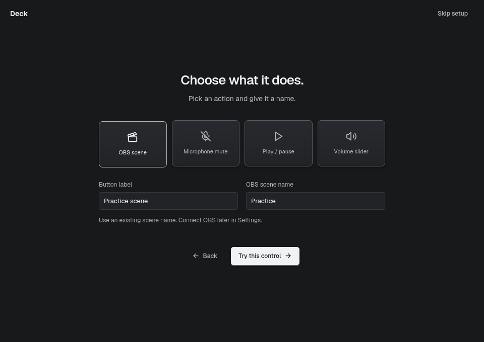
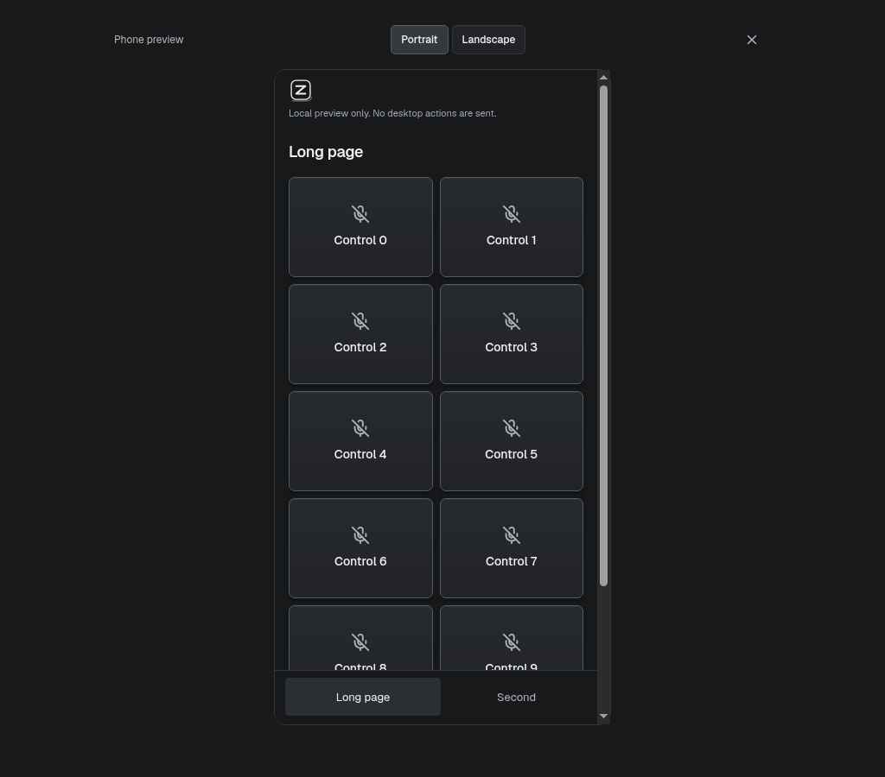
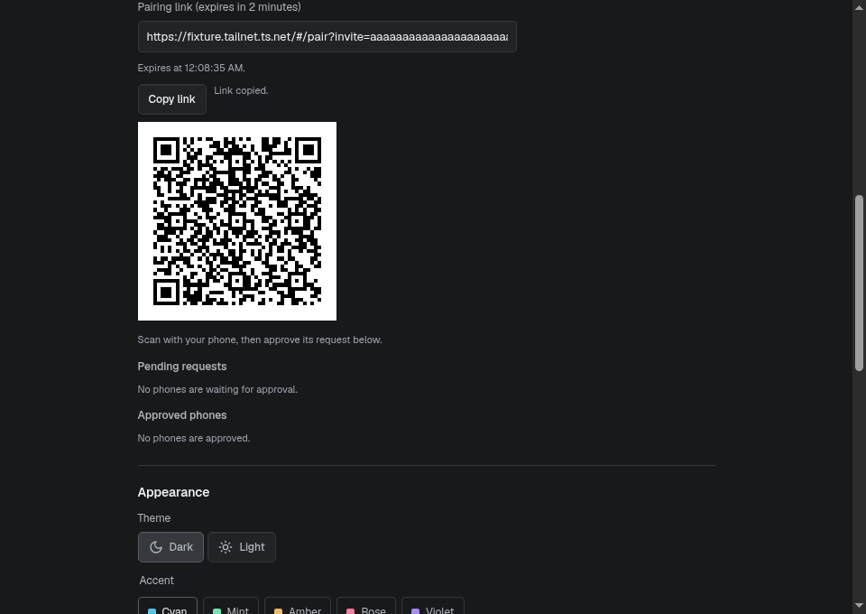
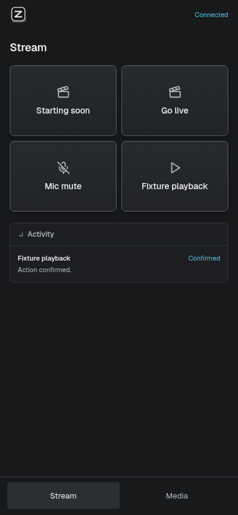
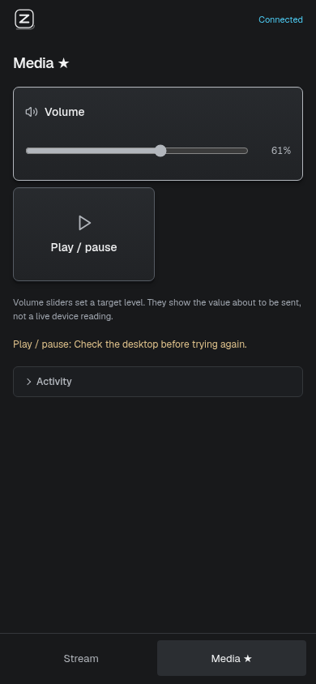
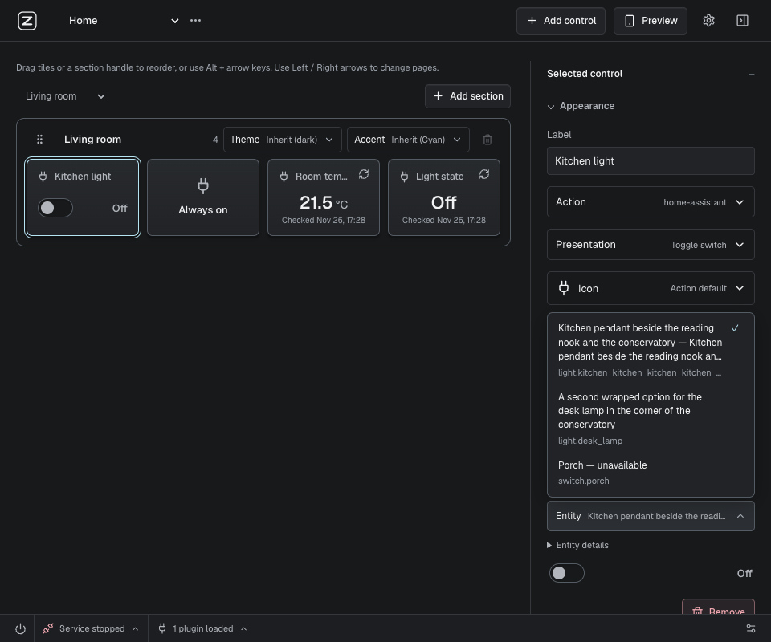
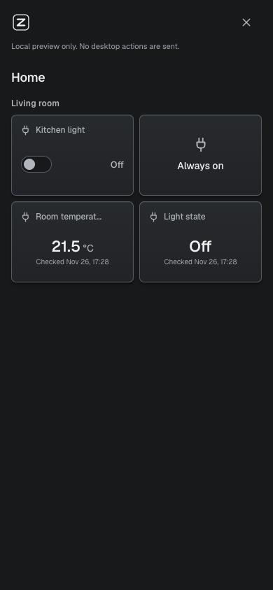
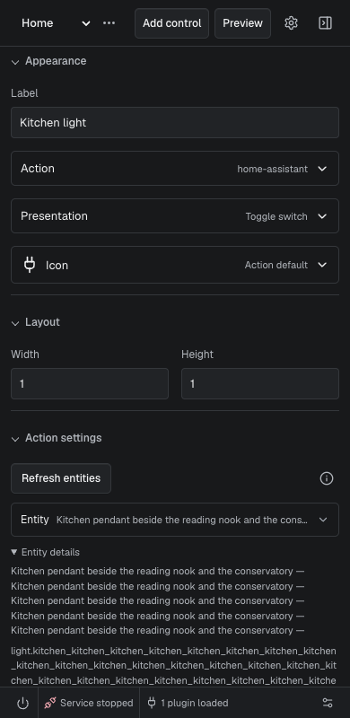

# Design review: build it, then try it

**Status:** the user likes the rehearsal-based onboarding, side Inspector, and phone preview. This refinement pass implements their follow-up feedback; final visual acceptance is still open. The project is now **zDeck**, with an original key-shaped z mark rather than a navbar wordmark.

## References and direction

The user requested a combination of [Touch Portal](https://www.touch-portal.com/) and [Hex](https://github.com/anomalyco/hex): direct button editing, compact pages, tactile controls, and focused, enjoyable onboarding.

We inspected Touch Portal’s official [main-window guide](https://www.touch-portal.com/blog/post/tutorials/understanding_section_pages.php), [button editor](https://www.touch-portal.com/blog/post/tutorials/button-edit-window-explanation.php), and [first-run guide](https://www.touch-portal.com/blog/post/tutorials/onboarding-touch-portal_v3.php), including their screenshots. For Hex we inspected its [design rules](https://github.com/anomalyco/hex/blob/e5f6dac8f9c92876bf449be0b50b24c1878f952b/docs/design-system.md), committed onboarding screenshots, and the actual onboarding state/transition and key-material code at that revision. No reference code, branding, or assets are included in zDeck.

- One compact toolbar: page switcher, page management, Add control, Inspector toggle, phone Preview, Settings. Desktop execution mode lives in the bottom status bar, not the toolbar.
- A recessed deck surface with shallow key edges, soft face shading, and a short downward press. No category-color decoration, numbered slots, decorative status lights, or slash-separated status labels.
- Glass is an opt-in third theme beside Dark (default) and Light. It uses a bright lilac wallpaper with large soft cyan and rose pools. The phone wallpaper follows the active section's theme, including a Glass section in a Dark deck. Phone sections are unframed; editor sections preview their own wallpaper. Individual smoked controls carry the material: four compact phone columns, circular one-button controls, capsules for wider controls, larger rounded scene/value modules, and a tall vertical volume pill whose white fill follows the real value. Active toggles turn luminous white with dark glyphs; inactive controls stay smoky. The selected accent stays authoritative; explicit saved spans are honored, with theme-only default spans when absent. Dark and Light keep their original horizontal controls and two/four-column rhythm. Solid enough backing keeps labels readable without backdrop blur, and reduced-motion/forced-colors rules still apply.
- Material research: [Hyalite](https://github.com/VII-Cae/hyalite--liquid-glass) and [Liquid Glass](https://github.com/nikdelvin/liquid-glass) distinguish actual SVG displacement/refraction from blur, tint and edge lighting. Their SVG-backdrop paths require engine-specific fallbacks. zDeck currently uses original CSS for the portable tint/blur/highlight approximation, not those packages or a claim of physically accurate refraction.
- Themes own the full presentation, not only color. A theme stylesheet may set visibility, size, position, order and shape of the existing stable control slots: `.tile-primary` (the button or static container), `.tile-icon`, `.tile-label`, `.tile-volume` with its native range input, `.tile-reading` and `.tile-toggle`. It may hide a visual label only where another accessible name already exists (a button `aria-label` or the range input's `<label>`), and it keeps the action, accessible name, focus target, hit area, disabled/unknown/reading-failed semantics and explicit saved spans intact. Glass hides visual labels on its circular icon-only controls and volume pill, enlarges/repositions those icons, and makes the whole volume pill the full-bleed native vertical track; Dark and Light keep their labelled horizontal controls. Shapes follow the resolved saved dimensions: a one-cell media control hides its visual label instead of squeezing text into a circle. Square phone grid units keep circles circular in portrait and landscape.
- Selected-control settings beside the deck on desktop; stacked beneath it at widths of 800px and below. In Editor, click a tile to select it and drag whole tiles with grab/grabbing cursors to reorder; there is no Position dropdown. Alt + Left/Right moves one slot, while Alt + Up/Down finds the adjacent visual row using actual tile bounds, including responsive columns and spanning tiles. The on-screen hint stays compact: “Drag tiles to reorder, or use Alt + arrow keys.” There are no separate drag handles. Tile interactions never execute desktop actions in Editor; explicit Inspector execution remains separate.
- Clicking outside tiles, the Inspector, and the status bar clears selection; Inspector fields, footer menus, and dialogs keep working. The rightmost navbar icon toggles the Inspector, including when controls are armed, without clearing tile selection. Collapsing removes the sidebar and its divider entirely; no chevron or empty rail remains. Explicit sidebar choices save immediately to browser/webview local storage (`deck.sidebar.v1`), separately from decks and transient Live state. Missing preferences default expanded; invalid or unavailable storage never blocks launch and shows an error. Save failures remain visible.
- A full-width, theme-matched status bar sits outside the scrolling editor/Settings content at the viewport bottom. A labelled power-icon toggle turns controls on/off, with its pressed state and accent showing when controls are armed. It preserves explicit opt-in, synchronized-save requirements, and automatic disarming on edits/navigation; turning off remains available even while re-arming is blocked. Browser builds keep the toggle disabled and announce **Preview only**. Compact accessible help explains the toggle and the distinction between editing, desktop live controls, and the simulated phone preview. Editor tiles do not replay entrance animations on reorder. Reordering does not post routine footer messages, and brief native saves do not flash a readiness banner; the arming action stays disabled until saving completes. Actual save errors remain visible.
- Optional service status uses a green globe when the local service is running and a red unplugged icon when stopped; failed observations become **Service unknown**, never stale green. This is local process status, not verified phone/network reachability. A lightweight read-only poll runs every two seconds while the document is visible; it never starts services, fetches pairing tokens, or lists device identities. Loaded plugins count only connected, error-free manifests, described as enabled plugins ready to provide controls. Service/plugin items open custom menus on click/right-click, with keyboard arrows, Escape/focus return, and outside dismissal. The service menu explicitly offers **Start service** and **Stop service**, disabling the inappropriate action and both during a request or when status is unknown. Start reuses the saved phone address, or opens connection settings when setup is needed. Action failures stay visible. Footer hover backgrounds fill each full-height section between dividers rather than inset rounded buttons.
- **Settings → Toolbar** configures service status, plugin count, and fine dividers. Choices save immediately under `deck.footer.v1`, outside decks/exports; no execution state is persisted. Invalid or blocked storage defaults safely with a visible error. The root and content scroller disable overscroll; content scrolls inside the app while toolbar/footer stay put. Touch targets expand for coarse pointers. Controls carry busy state; failures, uncertain delivery, pending-result checks, and necessary setup instructions remain visible. Chrome smoke covers placement, menus, preference round-trips, service observation failure/recovery, narrow layouts, and execution safeguards; native macOS trackpad bounce and Windows/Linux webviews still need device verification.
- Native action/page dialogs retain background inertness, Escape, and focus return, and now dismiss on backdrop clicks. A shared pointer-start/outside-rectangle check preserves inside padding clicks and inside-to-outside drags. The action picker focuses search on every opening.
- Actions are grouped under OBS, System, and Media headings. Compact category filters combine with search and reset on close. No oversized table of contents is needed for the current four actions.
- The Settings icon toggles back to the editor when clicked again. Remove has a visible danger-tinted surface/border at rest. Closed “About this preview” no longer reserves a flex gap below its summary.
- Default desktop window reduced from 1280×820 to **960×680** (minimum 760×540).

Dark tokens remain background `#18191b`, surface `#212326`, secondary text `#b2b6bc`, and primary text `#f1f2f3`. Light mode uses neutral gray/white surfaces. Accent is configurable and used sparingly for selection/focus. One self-hosted typeface, [Geist (OFL)](../src/assets/Geist-OFL.txt). No external font requests. The later pairing QR uses the MIT-licensed `qrcode-generator` locally.

## Onboarding in motion

[Watch the browser recording (WebM)](design/onboarding.webm). The GIF below shows the same real browser interaction, not a design mockup.

The recording captures the earlier visual checkpoint, before phone pairing was wired. Current setup points to Settings rather than saying pairing is unavailable.

The full-window flow deliberately shows one task at a time:

1. **Start with one button.** Try four example keys and watch the rehearsal respond: scene change, microphone mute, playback, or volume.
2. **Make it yours.** The welcome action choice carries forward automatically; enter a label and the scene name when relevant. Changing action is optional, tucked behind “Change action,” not a second mandatory picker. Blank labels/scenes cannot advance, and Back/Next preserves the draft.
3. **Give it a press / slide.** Rehearse the configured control. **Add to page** becomes available only after trying it; the destination is shown separately as “Page: Stream.” Adding appends exactly one control to that page and selects it for editing. The final note now points to “Connect your phone in Settings.”

Everything before Add is a local draft. Nothing runs on OBS, microphone, playback, or output volume during setup. Rehearsal outcomes are explicitly labelled; they do not claim observed native success. The sample deck is retained, not replaced. Existing saved decks go directly to the editor. Settings → **Replay setup** opens the flow without resetting work.

Skip is always available. Dismissal is remembered separately under `deck.setup.v1`, without writing a browser deck. If browser storage is blocked, dismissal lasts for the session. In-progress drafts do not resume after restart; the native store initializes its default document before onboarding and subsequent launches treat that as an existing deck. Pairing is a separate explicit Settings step, never part of rehearsal.

Motion uses short key entrances, a downward press, scene slides, and approximately 340ms step transitions. Supported browsers use the platform View Transition API; other browsers use a CSS entrance. Reduced-motion preference skips the view transition and shortens CSS animation. Each step focuses its heading; exiting focuses the editor page title. Action choices are ordinary keyboard-operable radio inputs.

## Desktop editor

## Phone preview

The phone retains touch-sized keys and bottom page navigation without editing tools. On desktop, an external **Landscape / Portrait** toggle changes the preview frame and grid; Landscape is the default. Long pages scroll inside the frame with page navigation reachable. On narrow/short real-phone viewports the desktop controls are hidden and the grid follows viewport orientation, without requesting orientation permissions. This setting is preview-only, not saved deck data.

These are implemented browser screens from isolated Chrome profiles: desktop/setup at 960×680, desktop device previews at 1024×900, and phone at 390×844. Screenshots wait for finite entrance animations to finish. The light editor includes a renamed test control; the 70% phone volume is a local preview value, not observed system output.

## Authenticated phone

The private service serves a separate phone surface, never the local editor or sample fallback. It starts with **Connect your phone** and supports pasting a fresh link inside the installed app, rather than assuming Safari/Brave/standalone cookies are shared. Explicit desktop approval unlocks saved pages and controls only after a live validated snapshot. Disconnection disables keys; an ambiguous result is **Unknown**, not an optimistic success. Sliders show local targets and commit only on deliberate release, not drag/cancel/blur. The shared user-applied update banner is also present here.

These are real Chrome screenshots at 390×844 against the Rust service through a disposable loopback HTTPS proxy. The fixture label distinguishes authoritative saved data from a preview fallback. No real OBS/audio action was run.

## Desktop pairing presentation

Settings names **Start/Stop local service** and distinguishes loopback availability from unverified phone access. Four short steps use subtly highlighted numbered circles; technical Serve setup and installation caveats live under **Connection help**. Connection help, Storage details, and About this preview share one native disclosure-row style, with centered text/chevron and no closed-state blank space. Native WebKit and Chrome geometry checks cover the alignment. Open the root HTTPS address on the phone first; only generate an invitation once that route works. Port 45829 is not a phone-facing endpoint, and Wi-Fi alone does not publish the app.

Expiry sits directly under the selectable link field, above **Copy link**, independently of copy feedback. The same expiring invitation is encoded into a locally generated black-on-white SVG QR with a four-module quiet zone. Replacement, expiry, stopping, or leaving Settings removes it. QR camera scanning normally opens a browser, so an installed iPhone app should still receive a fresh pasted link in its own session.

These Settings screenshots use an owned fake native-IPC adapter in an isolated browser, not a real invitation. An independent QR decoder recovered the exact fixture URL at the earlier QR checkpoint. Coordinator checks now pass **107 frontend tests**, **225 local UI browser checks**, **65 actual-service HTTPS checks**, native WebKit welcome/build/try/editor/Settings geometry smoke, and production/native debug builds. The user reports that the phone connected after manually configuring Tailscale Serve; these automated tests did not change Tailscale or establish physical camera/install coverage.

## Quieter phone controls

Preview now has an explicit 44px **Close preview** X at the top right: outside the device frame on desktop, in the header at narrow sizes. Only one is visible at each breakpoint. Authenticated phones never gain an editor route/close button. Neither surface shows a redundant control count.

Routine action outcomes live in a collapsed **Activity** disclosure with the last ten completed results, newest first, saved control labels and no persistence. Opening it exposes diagnostics without constant below-grid status noise. Connection status stays visible; pending marks the key. Unknown outcomes deliberately retain a visible check-the-desktop warning outside Activity, even after another action succeeds, until a new session/terminal cleanup. This avoids disguising an uncertain side effect as a failure that is safe to repeat.

Both screenshots use the real service with fake action adapters. Settings navigation/grouping, Spotify-specific player targeting, and QR artwork are separate future work.

## Home Assistant refinement

The design plan intentionally reuses zDeck rather than adding a new integration aesthetic: background `#18191b`, surface `#212326`, secondary `#b2b6bc`, primary `#f1f2f3`, configurable focus/accent (fixture `#4cc9f0`), and the existing Geist scale. Left-aligned Inspector fields remain in the existing compact disclosure grid; the deck keeps its shallow keys and established toggle switch/button. The meaningful addition is the reading itself, not extra explanation or status decoration.

New Power controls use observed-state toggles. Existing saved fixed buttons remain fixed; **Presentation → Button (fixed on/off)** exposes the explicit On press selector. The default toggle path has no extra behavior dropdown. Routine explanations moved to shared hover/focus/touch help, identity to optional **Entity details**, and transient success/default/reset/preview-action clutter was removed from plugin settings. Genuine failures remain visible.

The root fix gives Inspector grid/flex descendants a zero minimum width, rather than hiding document overflow. Shared dropdown triggers truncate selected values; options use a three-line friendly-name block, a quieter one-line entity ID, and a reserved first-line checkmark column. Full names/IDs remain accessible through accessible names/descriptions and selected Entity details. Menus constrain themselves to the nearest scrolling/viewport bounds and flip above the trigger when needed. The first screenshot critique caught oversized single-option rows and footer clipping; those were corrected before the final capture.

Separate read-only Light / switch state and Temperature controls show observed On/Off or sensor/thermostat current temperature with its unit. Unknown/unavailable is never zero, Off, or an executable read action. Readings carry a checked date/time so yesterday's snapshot cannot look like a new reading. Explicit dashboard Refresh is an observation, works without arming desktop actions, and uses a separate authenticated GET-only phone route; no automatic polling or replay is added. The phone preview only renders the cached snapshot and keeps its local-preview warning.

Owned fake fixtures cover 250+ character friendly names and unbroken IDs, selected/open/wrapped dropdowns, a 260px Inspector, 960/760/390px app widths, known/unknown toggles, fixed On/Off, Celsius/Fahrenheit, unavailable values, and phone rendering. `scripts/ha-ui-smoke.mjs` uses Brave with a fake native adapter: 18 layout cases measure scrollWidth/clientWidth and horizontal/menu viewport bounds, plus Escape/focus return, explicit refresh without action IPC, alternating On→Off targets, and actual Add control defaults. Screenshots and detailed measurements are also written to `/tmp/zdeck-ha-refinement/` by default. Run Vite on 1420 and Storybook on 6007 first; URLs/artifact directory are configurable for the script.

This checkpoint passes 349 frontend unit tests, 479 general browser smoke checks, 75 Storybook browser tests, 21 HA fake-fetch tests, 19 JS SDK tests (including its packed-artifact suite), 16 Python SDK tests, 67 Rust plugin-host tests, 18 schema tests, 36 native-core unit tests, and 41 real-loopback remote-service fixture tests (the HTTPS browser smoke remains ignored). Typecheck, production build and static Storybook build passed; `dist/plugins/home-assistant` was rebuilt after the frontend build. No installed plugin was enabled, real token read, HA/device contacted, dependency installed, registry project changed, or publication performed. These are browser/fake-process results, **not** live HA, physical-phone, signed-native, or Windows/macOS/Linux webview parity verification.

## Verification and limits

The earlier UI checkpoint passed **54 frontend tests**, **202 browser checks**, TypeScript, production build, and the Tauri debug no-bundle build. The browser suite covers all four rehearsal actions, repeated scene presses, draft validation/back navigation, required practice, save-on-Add, skip/replay persistence, a full page, keyboard activation and focus, radio arrows, reduced motion, light mode, short/narrow layouts, welcome-to-configuration continuity, optional action disclosure, category filtering/keyboard access, backdrop pointer interaction, Settings toggling, brand identity, preview orientation/scrolling, and the existing editing/dialog/slider/offline/update behavior. The coordinator reviewed the DeepSeek worker’s diff/screenshots and independently reran checks; an earlier read-only review’s minor documentation, length-limit, and dead-style findings were also addressed.

The connection checkpoint adds authenticated phone rendering and fail-closed server routing, without changing saved schema, app/storage/protocol identifiers, or desktop authority. Unit coverage includes late/canceled responses, hidden-page suspension, uncertain actions and bounded requests; actual-service browser coverage includes pairing, real HTTP/WSS snapshots, saved fake actions, live revisions, conflict resync, revocation and offline/auth boundaries. The coordinator independently passed **93 frontend tests**, **202 local UI browser checks**, **62 actual-service HTTPS browser checks**, and **70 default Rust tests**, plus typecheck and production/Tauri debug builds. See the README for reproducible checks.

Swipeable panels within pages and per-page themes remain planned migrations; appearance controls are still global. Physical iPhone/Android installation, Safari/Brave-specific behavior, bundled phone-asset resolution, and the full real OBS/audio checklist remain unverified. The user reports successful phone connection after manually setting up Tailscale Serve, but media play/pause did not affect the intended player; read-only inspection found Gwenview first in the default MPRIS player list. A later AMD/Wayland check with isolated data passes after aligning the Nix shell's Mesa EGL/GBM loaders with its glibc and guarding GTK's unset DPI before WebKit starts. It verifies native welcome/build/try/editor/Settings geometry (positive pixel ratio, viewport/font sizes, content widths, disclosure and numbered-step alignment, and no overflow), not comprehensive visual QA. The user also confirmed that the collapsed native layout is fixed. An isolated Chromium HTTPS test is not a real-device result.
