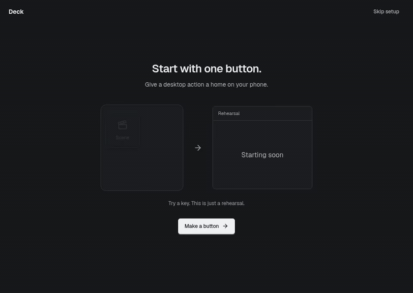
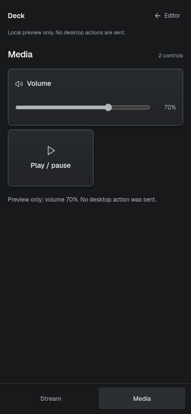

# Design review: build it, then try it

**Status:** implemented and ready for feedback, not declared final. This replaces the inline-guide pass, which the user found confusing and too generic.

## References and direction

The user requested a combination of [Touch Portal](https://www.touch-portal.com/) and [Hex](https://github.com/anomalyco/hex): direct button editing, compact pages, tactile controls, and focused, enjoyable onboarding.

We inspected Touch Portal’s official [main-window guide](https://www.touch-portal.com/blog/post/tutorials/understanding_section_pages.php), [button editor](https://www.touch-portal.com/blog/post/tutorials/button-edit-window-explanation.php), and [first-run guide](https://www.touch-portal.com/blog/post/tutorials/onboarding-touch-portal_v3.php), including their screenshots. For Hex we inspected its [design rules](https://github.com/anomalyco/hex/blob/e5f6dac8f9c92876bf449be0b50b24c1878f952b/docs/design-system.md), committed onboarding screenshots, and the actual onboarding state/transition and key-material code at that revision. No reference code, branding, or assets are included in Deck.

- One compact toolbar: page switcher, page management, Add control, Preview, Settings.
- A recessed deck surface with shallow key edges, soft face shading, and a short downward press. No category-color decoration, numbered slots, decorative status lights, or slash-separated status labels.
- Selected-control settings beside the deck on desktop; stacked beneath it at widths of 800px and below. Reordering stays in the Inspector, not on every key.
- Native action/page dialogs retain background inertness, Escape, and focus return. The action picker focuses search on every opening.
- Default desktop window reduced from 1280×820 to **960×680** (minimum 760×540).

Dark tokens remain background `#18191b`, surface `#212326`, secondary text `#b2b6bc`, and primary text `#f1f2f3`. Light mode uses neutral gray/white surfaces. Accent is configurable and used sparingly for selection/focus. One self-hosted typeface, [Geist (OFL)](../src/assets/Geist-OFL.txt). No new dependencies or external font requests.

## Onboarding in motion

[Watch the browser recording (WebM)](design/onboarding.webm). The GIF below shows the same real browser interaction, not a design mockup.

The full-window flow deliberately shows one task at a time:

1. **Start with one button.** Try four example keys and watch the rehearsal respond: scene change, microphone mute, playback, or volume.
2. **Choose what it does.** Pick an action, enter a label, and set the scene name when relevant. Blank labels/scenes cannot advance.
3. **Give it a press / slide.** Rehearse the configured control. Add becomes available only after trying it; adding appends exactly one control to the current page and selects it for editing.

Everything before Add is a local draft. Nothing runs on OBS, microphone, playback, or output volume during setup. Rehearsal outcomes are explicitly labelled; they do not claim observed native success. The sample deck is retained, not replaced. Existing saved decks go directly to the editor. Settings → **Replay setup** opens the flow without resetting work.

Skip is always available. Dismissal is remembered separately under `deck.setup.v1`, without writing a browser deck. If browser storage is blocked, dismissal lasts for the session. In-progress drafts do not resume after restart; the native store initializes its default document before onboarding and subsequent launches treat that as an existing deck. Phone pairing remains unwired and the final step says so.

Motion uses short key entrances, a downward press, scene slides, and approximately 340ms step transitions. Supported browsers use the platform View Transition API; other browsers use a CSS entrance. Reduced-motion preference skips the view transition and shortens CSS animation. Each step focuses its heading; exiting focuses the editor page title. Action choices are ordinary keyboard-operable radio inputs.

## Desktop editor

## Phone preview

The phone retains touch-sized keys and bottom page navigation without editing tools.

These are implemented browser screens from isolated Chrome profiles: desktop/setup at 960×680, phone at 390×844. Screenshots wait for finite entrance animations to finish. The light editor includes a renamed test control; the 70% phone volume is a local preview value, not observed system output.

## Verification and limits

Coordinator reran **54 frontend tests**, **160 browser checks**, TypeScript, production build, and the Tauri debug no-bundle build. The browser suite covers all four rehearsal actions, repeated scene presses, draft validation/back navigation, required practice, save-on-Add, skip/replay persistence, a full page, keyboard activation and focus, radio arrows, reduced motion, light mode, short/narrow layouts, and the existing editing/dialog/slider/offline/update behavior. A separate read-only DeepSeek review found no high/medium defects; its minor documentation, length-limit, and dead-style findings were addressed.

Saved deck schema, desktop authority, native execution guards, credentials, and remote-service behavior are unchanged. This is still a local editor and phone preview, not a paired remote controller. Native WebKit/Wayland rendering, physical phones, real OBS/audio controls, and HTTPS installation were not validated in this pass. Backend Rust tests were not rerun for these UI/config-only changes.
