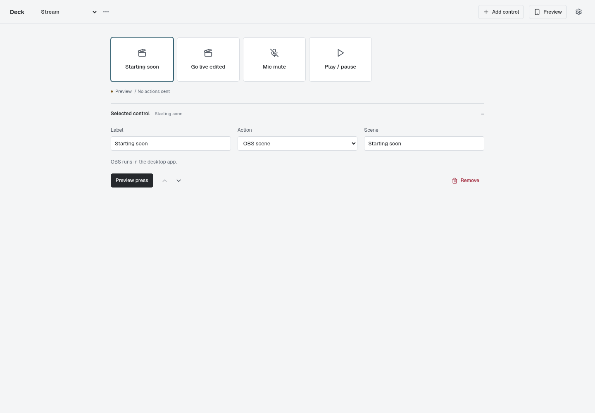
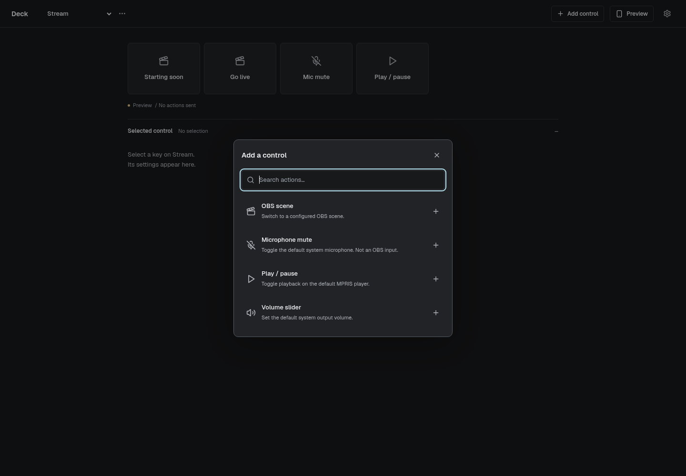
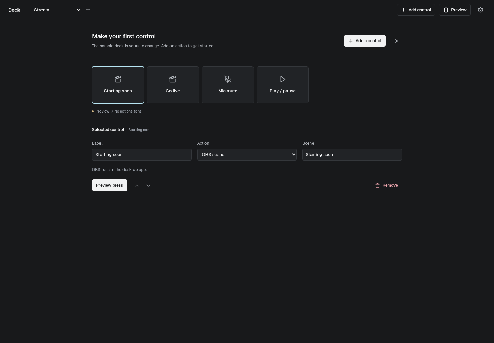

# Design review: a clean local editor

**Status:** the user approved this layout direction; the implemented pass is ready for visual feedback, not declared final.

## Direction

[Hex](https://github.com/anomalyco/hex) is a reference for restraint and usability, not a template to copy. We inspected its committed light/dark screenshots, onboarding, and [design rules](https://github.com/anomalyco/hex/blob/e5f6dac8f9c92876bf449be0b50b24c1878f952b/docs/design-system.md). No Hex code, branding, or assets are included.

- One toolbar: page switcher, page management, Add control, Preview, Settings.
- Neutral controls with clear labels; no mandatory category colors, decorative numbers, console styling, or floating device frame.
- Selected-control settings directly beneath the deck. Reordering lives here, rather than on every key.
- Searchable action picker and page manager appear only when requested.
- A non-blocking first-run guide: add an action, configure it, try a safe local preview. Existing saved workspaces do not start the guide. Dismissal without saving any browser changes lasts for the current session; this is not a resumable tour.
- Native modal dialogs provide background inertness, Escape, and focus return. The action picker explicitly focuses search on each opening. Chrome can hand Tab to browser chrome between cycles; the tests distinguish that from entering the inert background app.

Dark tokens: background `#18191b`, controls `#212326`, borders `#34373b`, secondary text `#b2b6bc`, primary text `#f1f2f3`. Accent remains configurable and is used sparingly for selection/focus. Light mode uses neutral gray/white surfaces. One self-hosted typeface, [Geist (OFL)](../src/assets/Geist-OFL.txt); ordinary 12–14px UI text, with larger titles only where useful. No new dependencies or external font requests.

## Desktop editor

## Add a control

## First run

## Phone preview

The phone retains touch-sized controls and bottom page navigation without editing tools.

These are implemented browser screens, captured in isolated Chrome profiles at 1440×1000 and 390×844. The light screenshot includes a renamed test control. The 70% volume is a local preview value, not observed system output.

## Verification and limits

52 frontend tests and 108 browser checks pass, including page/control editing, persistence, cross-tab synchronization, onboarding, modal focus/search/keyboard behavior, slider keyboard/touch interaction, 320px layouts with 24 long-labelled controls, offline shell, and the two-build user-applied update flow. Dark/light desktop, action picker, phone portrait/landscape, and first-run screenshots were reviewed.

Saved deck schemas, desktop authority, native execution guards, credentials, and remote-service behavior are unchanged. This remains a local editor and phone preview: pairing is not wired to the UI. Native WebKit/Wayland rendering, physical phones, real OBS/audio controls, and HTTPS installation were not validated in this pass.
